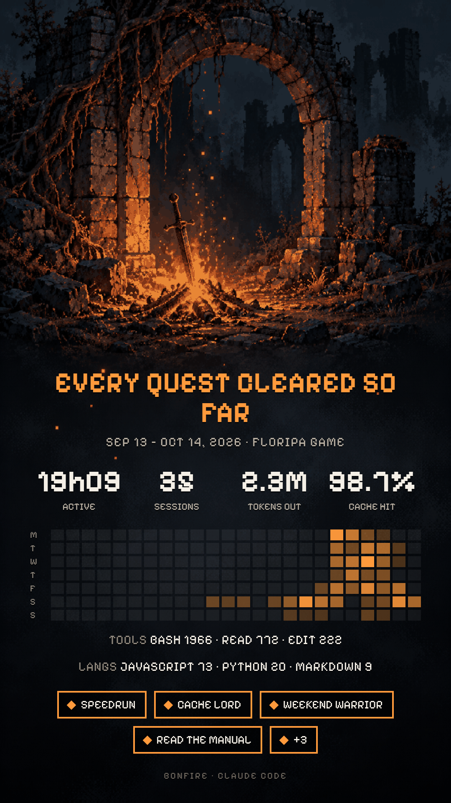

# bonfire

A "Strava for devs": reads your local Claude Code usage, produces a summary with
**aggregated numbers only** (no prompts, paths or code), computes achievements and
renders a PNG card over pixel-art backgrounds inspired by video game save points and
TV series (bonfire, bench, typewriter, captain's log…) for posting.

<p align="center">
  
</p>

Status: **working, personal use** (16 themes). See [docs/PLAN.md](docs/PLAN.md) and
[docs/ART-PROMPTS.md](docs/ART-PROMPTS.md).

## Production

Not published: personal use only for now. The name `bonfire` clashes with the
`vieko/bonfire` plugin (cross-session memory); if this ever becomes a plugin, pick a
more distinctive name first. The `ricardobz/bonfire` repository on GitHub is public.

## Usage

Install the skill once (works in any project; open a new session afterwards).
From the folder where you cloned this repo:

```sh
ln -s "$(pwd)/skills/bonfire" ~/.claude/skills/bonfire
```

| When | Command | Period | Default theme |
|---|---|---|---|
| End of the day | `/bonfire day` | today | end-of-day |
| End of the week | `/bonfire` or `/bonfire week` | 7 days | bonfire |
| End of the sprint | `/bonfire sprint` | 15 days | mdr-terminal |
| End of the month | `/bonfire month` | 30 days | typewriter |
| Everything there is | `/bonfire all` | since the oldest log | typewriter |
| Skip the theme question | `/bonfire week --theme captains-log` | | the one you pick |
| Only some projects | `/bonfire day --paths ~/code/my-app` | | |
| Project name on the card | `/bonfire all --paths ~/code/my-app --alias "My App"` | | |

The skill shows the numbers first, asks for the theme, saves the PNG to
`~/Pictures/bonfire/<date>-<period>-<theme>.png` and suggests captions for the post.
For privacy the card only shows "N projects"; `--alias` replaces that with a name
you type (it never comes from the path).
Themes: the ids in `data/themes.json`.

- "Week" = the last 7 days including today: run it on the same weekday (e.g. Friday)
  to compare weeks.
- Without Claude (no preview or captions, no tokens spent):

  ```sh
  cd path/to/bonfire
  python3 recap.py --days 7 --out /tmp/recap.json   # 1, 7, 15, 30 or all
  python3 render.py /tmp/recap.json --theme bonfire --out ~/Pictures/bonfire/week.png
  ```

  `render.py` accepts `--alias "Name"`.

- "All" goes as far back as the logs do: Claude Code cleans up old sessions
  (`cleanupPeriodDays` in `~/.claude/settings.json`). On 2026-10-14 there were logs
  back to 2026-08-26 (50 days).
- Above 7 days the card's heatmap sums by weekday (Mon to Sun × 24 hours).

## Run locally

Python 3 only (stdlib). The collector prints the aggregated JSON:

```sh
python3 recap.py --days 7                       # week, all folders
python3 recap.py --days 1 --paths ~/code/x      # today, only these folders
python3 -m unittest discover tests              # includes the leak test
```

PNG card (1080x1920, needs Google Chrome or Chromium; `BONFIRE_CHROME` points to
another binary):

```sh
python3 recap.py --days 7 --out recap_week.json
python3 render.py recap_week.json --theme bonfire --out card.png
```

Themes in `data/themes.json` (background, color, title per period); layout in
`card/card.html` + `card/card.css`; Pixelify Sans font (OFL) in `assets/fonts/`.

Skill: `skills/bonfire/SKILL.md` (see "Usage" above).

Achievements: rules in `data/achievements.json`, evaluated by `achievements.py` and
included in the recap JSON.

## Deploy

None: runs locally (personal use). `git push` only updates the repository.
